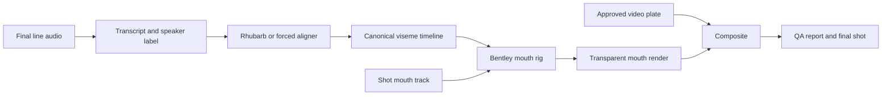

# High Quality Lipsync System Implementation Plan

> **For agentic workers:** REQUIRED SUB-SKILL: Use `superpowers:subagent-driven-development` or `superpowers:executing-plans` to implement this plan task-by-task. Steps use checkbox (`- [ ]`) syntax for tracking.

**Goal:** Build a reusable, high-quality lip-sync system for Bentley's Big Adventures that keeps continuous cinematic shots, preserves animal character design, supports species-appropriate teeth, and stops wasting AI video credits on repeated mouth-sync rerolls.

**Architecture:** Treat lip-sync as a deterministic character-animation layer, not as a full-frame generative-video problem. Final voice audio is converted into timed visemes, those visemes drive an authored Bentley mouth rig, and the rendered mouth pass is composited back into otherwise approved shots.

**Tech Stack:** Python, ffmpeg, Rhubarb Lip Sync, project VO assets, optional Blender shape keys for the long-term rig, and repository-local QA scripts.

---

## Status

Date: 2026-07-01. **ADOPTED WITH AMENDMENTS by the owner 2026-07-01** after a multi-agent
review (10 findings confirmed, 1 refuted). The amendments are integrated inline below and marked
`[AMENDED]`. Owner decisions locked at adoption:

- **Teeth policy: v1 ships 100% TOOTHLESS** (dark mouth interior + tongue only — the rig physically
  can't grin). Puppy-tooth hints are a **v2 owner-opt-in**: allowed only in `AI`/`OPEN_JAW` variants,
  and only after the owner approves a rendered still sheet. (Canon per `LOCKED_ELEMENTS.md`: natural
  dog teeth are allowed — HUMAN teeth/smiles are banned — but toothless-first is the cheaper, safer
  build order.)
- **OWNER-LOCKED exception:** Bentley's signature **"Stop. Look. Listen."** moment stays a
  Kling-Avatar tight face-CU per `episode-production` SKILL §0.3/§7. The rig system does not touch it.

This document is the PROPOSED supersession of the "tight Avatar close-up is mandatory" guidance in
`docs/guides/TALKING_LIPSYNC_METHOD.md` for EP3+ continuous dialogue shots. **The supersession takes
effect only when the Phase-3 test passes its Definition of Done AND the owner signs off on the
result.** Until then, `episode-production` SKILL §0.3 (VO-over-alive + catchphrase-Avatar-only)
remains the production default.

That older method remains correct for intentionally framed front-facing close-ups (and permanently
for the catchphrase). It is not the right default for continuous two-shots, side angles, small
characters in frame, or shots where the animal mouth must remain on-model.

## Correction To The Mouth Requirement

The earlier shorthand "toothless" is incorrect.

Bentley does have teeth. The production requirement is:

- Bentley may show stylized dog or puppy teeth.
- Teeth must be canine, simple, rounded or slightly pointed, and integrated into the muzzle.
- Teeth must not become human teeth: no flat rectangular human incisor rows, no human gum line, no broad human smile arc, no white veneer grin.
- The mouth must remain muzzle-shaped, with jaw, snout, cheeks, tongue, and small dog teeth working together as a dog mouth.

So the correct rig target is not "toothless." The correct target is "species-appropriate Bentley mouth shapes."

## Current Challenge

The EP3 lip-sync problem is not just "make the mouth move." The actual challenge is more specific:

- Preserve the current cinematic episode style, especially continuous shots and two-character compositions.
- Keep Bentley and Marco on-model during dialogue.
- Match final voice audio closely enough that the performance feels intentional.
- Avoid humanized animal faces.
- Avoid cutting every line into tight front-facing Avatar close-ups.
- Avoid full-video rerolls when only the mouth is broken.
- Keep production cost predictable.

The current AI model approaches split into two failure modes:

| Approach | What it does well | What breaks |
|---|---|---|
| Image-to-video scene generation | Good scene continuity, camera motion, backgrounds, and broad character presence | No reliable audio-driven mouth sync; mouth can flap or "cough" out of time |
| Avatar/talking-head generation | Better word-timed mouth motion on tight, bright, front-facing face crops | Breaks wide shots and two-shots; can humanize the muzzle; often forces choppy cutaways |
| Full-shot rerolls | Sometimes fixes one defect | Spends credits on the whole frame even when only the mouth needs deterministic control |

The 00:24-00:35 EP3 experiment proved only a narrow technical point: Rhubarb timings can be generated from audio and used to drive a mouth overlay. It did not create the final production rig. It was a temporary patch over the plate, not a professional reusable mouth system.

Important distinction:

- The POC showed that audio-to-viseme timing is viable.
- The POC did not author the required mouth poses.
- The POC did not solve the final visual design.
- The POC should not be treated as a finished character rig.
- Any historical file name that says "toothless" is now conceptually outdated.

## Current Waste Of Money On AI Tokens And Credits

The expensive mistake is asking a full-frame AI video model to solve a small, repeatable, deterministic animation problem.

Every time we reroll a video because the mouth is wrong, we are paying for:

- the background again;
- the camera motion again;
- character bodies again;
- lighting again;
- all non-speaking parts of the frame again;
- and only incidentally the few pixels around the mouth.

That is a bad production economy.

The wasted AI spend shows up in several ways:

- **Non-reusable pixels:** A failed AI render does not improve the next shot. It creates another discarded video file.
- **Same failure paid for repeatedly:** Human teeth, human grins, off-model muzzles, and unsynced mouth flaps recur because the model is not receiving a reusable mouth rig.
- **Wrong unit of work:** Lip-sync is per phoneme, per line, per mouth shape. AI video bills for the entire moving frame.
- **No compounding asset value:** A rigged mouth library gets better with every correction. AI rerolls usually do not.
- **Creative compromise:** To make Avatar work, we are pushed toward tight front-facing close-ups even when the desired episode language is continuous cinematic storytelling.
- **Review fatigue:** The team spends time judging whole-shot variants instead of making targeted mouth corrections.

The better financial model is:

- Spend AI credits on things AI is good at: plates, backgrounds, motion ideas, camera, atmosphere, establishing shots, and broad acting.
- Stop spending AI credits to rediscover Bentley's mouth from scratch in every dialogue shot.
- Build the mouth system once, then use local deterministic rendering for every line.

## How Professional Studios Usually Do This

Professional animation studios do not normally ask a generative video model to invent a new mouth on every shot.

The standard workflow is:

1. **Final or near-final voice is locked.**
   The performance drives timing. Editors and animators work from real line reads, not guessed mouth motion.

2. **Dialogue is broken into phonemes or visemes.**
   A tool, assistant editor, or animator creates a timing track that says when the mouth should be closed, open, wide, rounded, pursed, tongue-forward, and so on.

3. **The character has an authored mouth rig.**
   The mouth shapes are designed once to match the character. For Bentley, this means dog muzzle shapes with dog teeth. For Marco, this means insect/ant-style mouth mechanics, not human lips.

4. **Auto lip-sync is used as blocking, not final acting.**
   Tools can generate a first pass, but animators polish the important lines. They adjust emphasis, holds, blinks, jaw overlap, and expression.

5. **Animators keep the character design in control.**
   The rig physically prevents unacceptable shapes. If human teeth are not in the rig, the character cannot suddenly get human teeth.

6. **Compositing integrates the mouth pass into the shot.**
   The mouth is color-matched, blurred, grain-matched, and merged into the original plate. The shot stays intact.

7. **QA is done against both sync and character canon.**
   A shot can be technically synced and still fail if it looks like a human mouth pasted onto a dog.

The key lesson: studios separate the problem into assets, timing, animation, compositing, and QA. They do not keep paying for complete new shots to fix mouth shapes.

## Target System Overview



The core idea is simple:

- AI video creates or preserves the approved shot.
- The lip-sync system owns the speaking mouth.
- Compositing combines them.

## Character Mouth Design Rules

### Bentley

Bentley's mouth rig must be built as a dog muzzle, not as a human mouth with fur.

Required design rules:

- Muzzle volume stays visible in every mouth shape.
- Mouth corners do not stretch into a human smile.
- Upper and lower teeth, when visible, are simplified dog teeth.
- Small canine/fang hints are allowed where appropriate.
- Tongue can appear in open shapes, but it should not look like a human tongue pose.
- Closed mouth shapes preserve the snout silhouette.
- Jaw movement should feel hinged under the muzzle, with soft cheek compression.
- Whisker dots, mask edge, grey chin, and muzzle color must not swim between frames.

Rejected design outcomes:

- human rectangular tooth rows;
- orthodontic-looking teeth;
- gum-heavy smile;
- wide human grin;
- flat sticker-mouth pasted onto the face;
- mouth shapes that ignore the snout direction;
- teeth that appear in every phoneme whether needed or not.

### Marco

Marco should not use the Bentley mouth system directly.

Marco needs a separate insect-style speech design:

- small mandible or mouth plate motion;
- readable open/closed shapes;
- tiny shape changes timed to audio;
- no human lips;
- no dog teeth;
- no broad smile mechanics unless the approved character design explicitly supports it.

Marco can use the same timing pipeline, but not the same mouth artwork.

**[AMENDED] Marco waiver rule (he is ~41% of EP3's character lines — his scope must be explicit,
not silently deferred):** no viseme pass for mouths under **~24 px tall on screen**; such shots get
a simple 2-state open/close or nothing (VO-over-alive). Audit Marco's lines against this threshold
BEFORE budgeting his shape set — most of his shots frame him tiny and will be waived for free. Only
the surviving close-ups justify insect mouth artwork.

## Bentley Viseme Set

The first production-quality Bentley rig should include these shapes.

| Internal shape | Purpose | Bentley design note |
|---|---|---|
| `REST_CLOSED` | Silence, listening, between phrases | Relaxed muzzle, mouth seam visible, no teeth |
| `MBP` | M, B, P closures | Firm closed lips/muzzle compression, no teeth |
| `AI` | A, I, open vowels | Open dog mouth, dark interior, optional tongue/puppy tooth hints |
| `E` | E, ee, tight wide vowels | Slightly wider but still muzzle-shaped, no human smile row |
| `O` | O, aw, rounded vowels | Rounded dog mouth under snout, not a human kiss/pucker |
| `U` | U, oo, w-like rounding | Small forward rounded muzzle opening |
| `FV` | F, V contact | Dog-safe contact shape; do not copy human upper-teeth-on-lower-lip anatomy literally |
| `L` | L, tongue-forward sounds | Optional small tongue cue, still animal-stylized |
| `WQ` | W, Q transitions | Optional helper for rounded starts |
| `OPEN_JAW` | Emphasis, surprise, laughs, pants | Larger open mouth with dog tongue and species-appropriate teeth |
| `BREATH` | Soft pant, breath, non-word mouth life | Optional performance layer, not tied to every phoneme |

Minimum viable production set:

- `REST_CLOSED`
- `MBP`
- `CONS` — **[AMENDED]** slightly-open consonant shape (receives Rhubarb `B`, ~half of all voiced time)
- `AI`
- `E`
- `O`
- `U`
- `FV`
- `L`

**[AMENDED] v1 teeth policy (owner-locked):** every minimum-set shape is authored TOOTHLESS — dark
mouth interior + tongue only. Tooth hints are v2 variants of `AI`/`OPEN_JAW` only, after owner
approval of a still sheet.

Professional-quality set:

- all minimum shapes;
- plus `WQ`, `OPEN_JAW`, `BREATH`;
- plus left/right or angle variants for front, three-quarter, and side shots.

## Rhubarb To Project Viseme Mapping

Rhubarb outputs a generic mouth-shape alphabet. The project should not use those symbols directly in the renderer. It should map them into Bentley-specific visemes.

Example mapping:

| Rhubarb cue | Project viseme | Notes |
|---|---|---|
| `A` | `MBP` | Lip closure for M/B/P only |
| `B` | `CONS` | **[AMENDED]** Rhubarb `B` is a SPEECH shape — slightly-open, clenched-teeth consonants (K/S/T/D...) and the EE vowel. It fires for ~40–60% of voiced time. Mapping it to a closed mouth produces a ventriloquist look (the original table's `B → REST_CLOSED` was a verified blocker; the POC's own working value was 0.30 open). `CONS` = a dedicated slightly-open shape (may be authored as a narrow `E`). |
| `C` | `AI` | Open vowel |
| `D` | `OPEN_JAW` | **[AMENDED]** deterministic: `D` (wide-open AA) always maps to `OPEN_JAW`; if the character set lacks it, fall back to `AI` at full intensity. No "or" in the adapter. |
| `E` | `O` | Rounded mid-open vowel |
| `F` | `U` | Rounded/pursed vowel (`WQ` optional upgrade) |
| `G` | `FV` | Must be redesigned as a dog-safe contact pose |
| `H` | `L` | Tongue cue |
| `X` | `REST_CLOSED` | Silence/rest — **the ONLY cue besides `A` that may close the mouth** |

**[AMENDED] Rule enforced by unit test:** no Rhubarb cue other than `X` and `A` may map to a fully
closed shape (`tests/test_lipsync_visemes.py` asserts this).

**[AMENDED] Rhubarb invocation contract** (was missing; all verified against rhubarb v1.14.0):

- The binary is vendored at `tools/rhubarb/` (relocated out of disposable `scratch/`), version pinned
  in the module config. It is NOT on PATH.
- Rhubarb accepts **WAV/OGG only** — all production VO is MP3, so the adapter always transcodes
  first: `ffmpeg -i line.mp3 -ar 16000 -ac 1 line.wav`.
- Always pass **`--dialogFile line.txt`** with the line's REAL transcript (we have every transcript;
  this is a free, material accuracy win).
- Pin **`-r pocketSphinx`** (English VO) and **`--extendedShapes GHX`** explicitly — the mapping
  table above depends on G/H/X existing; never rely on defaults.
- Validate every output cue against the known alphabet; unknown cue = hard error before rendering.

The adapter should be editable per character. Bentley and Marco should share timing infrastructure, not mouth anatomy.

## Data Contracts

### Line Manifest

Each line should have a manifest entry so the process is repeatable.

```json
{
  "episode": "ep3",
  "shot_id": "ep3_00_24_00_35",
  "source_video": "episodes/ep3/final_delivery/EP3_v9_FIXES.mp4",
  "clip_start_sec": 24.0,
  "clip_end_sec": 35.0,
  "speaker": "bentley",
  "line_id": "B_tooheavy",
  "audio_path": "episodes/ep3/vo/B_tooheavy.mp3",
  "audio_wav_derived": "work/lipsync/wav/B_tooheavy.wav",
  "transcript_path": "episodes/ep3/vo/B_tooheavy.txt",
  "shape_set": "assets/lipsync/bentley/mouth_shapes/v1/manifest.json",
  "mouth_track": "episodes/ep3/lipsync/tracks/<plate_id>.json",
  "angle": "three_quarter_left",
  "notes": "Continuous shot. Preserve plate. Replace only Bentley mouth region."
}
```

**[AMENDED]** `audio_path` is the real production MP3 (the original example referenced a
nonexistent `.wav` with an invented transcript); the WAV is derived by the adapter. Transcripts come
from the real VO line files — never retyped into manifests (a wrong transcript fed to `--dialogFile`
actively degrades cue accuracy). `mouth_track` is keyed by PLATE, not by line, so it is reused
across every line on that plate.

### Mouth Track

The mouth track locates Bentley's mouth in the shot over time.

```json
{
  "video_fps": 24,
  "coordinate_space": "source_video_pixels",
  "keyframes": [
    {"time": 0.0, "x": 812, "y": 428, "scale": 1.0, "rotation_deg": -4.0, "visible": true},
    {"time": 2.0, "x": 818, "y": 430, "scale": 1.02, "rotation_deg": -3.0, "visible": true},
    {"time": 5.0, "x": 826, "y": 433, "scale": 1.04, "rotation_deg": -2.0, "visible": true}
  ]
}
```

### Viseme Timeline

The viseme timeline should be local to the clip or line, with explicit timing.

```json
{
  "line_id": "B_tooheavy",
  "speaker": "bentley",
  "start_sec": 3.15,
  "cues": [
    {"start": 3.15, "end": 3.27, "viseme": "MBP", "source": "rhubarb:A"},
    {"start": 3.27, "end": 3.44, "viseme": "AI", "source": "rhubarb:C"},
    {"start": 3.44, "end": 3.61, "viseme": "O", "source": "rhubarb:E"}
  ]
}
```

## Recommended Implementation Path

### Phase 0: Stop The AI Credit Bleed

Rule: if a shot is otherwise acceptable and only the mouth is bad, do not reroll the whole video as the first fix.

- [ ] Mark lip-sync defects separately from full-shot defects in QA.
- [ ] Use AI video rerolls only when the plate, body acting, camera, or composition is wrong.
- [ ] Use the lip-sync system when the plate is good but the mouth is wrong.
- [ ] Update `docs/guides/TALKING_LIPSYNC_METHOD.md` to point to this document for continuous dialogue scenes.
- [ ] **[AMENDED] THE CLOSED-MOUTH PLATE RULE (free, highest-leverage, was missing):** every dialogue
      plate destined for rig lip-sync is generated with the speaking character's **mouth CLOSED /
      calm** (prompt: "mouth closed, calm attentive expression" — never "talking/mouth moving").
      Kling i2v otherwise bakes in out-of-sync mouth flapping, which forces expensive paint-out
      before the rig mouth can be placed. A closed-mouth plate means the rig owns 100% of mouth
      motion and "replace mode" mostly disappears. NOTE: this inverts the current
      `episode-production` SKILL §0.3/§5 "prompted hard for natural talking" guidance — that
      guidance stays in force for VO-over-alive shots UNTIL the rig system is adopted; from rig
      adoption onward, rig-destined plates use closed mouths.

### Phase 1: Build Bentley's 2.5D Mouth Shape Sheet

This is the fastest path to a real production test on the 00:24-00:35 clip.

**[AMENDED] THE AUTHORING PATH (the plan said "authored" 5 times without saying by whom — this
project has no illustrator; everything is generated):**

1. Generate the whole viseme chart as **ONE image**: a labeled grid of all 9 mouth poses on the
   IDENTICAL Bentley muzzle crop (same angle, lighting, framing), generated with our image models
   (`gpt-image-2-image-to-image` / `google/nano-banana-edit`) from the locked
   `Bentley_MASTER_pixar.png` close-up. One grid forces style/proportion/lighting consistency that
   9 separate generations would drift on.
2. Generate 3–4 candidate grids, **owner hand-picks one** (never auto-batch — standing rule).
3. Crop the winning grid into the individual transparent patch PNGs below; standardize anchor/scale
   in the manifest.
4. All v1 shapes TOOTHLESS (owner-locked). Fallback if grid generation can't hold consistency:
   one-time human commission of the 9 shapes (~$50–200) — acceptable but slower.

Files to create:

- `assets/lipsync/bentley/mouth_shapes/v1/manifest.json`
- `assets/lipsync/bentley/mouth_shapes/v1/rest_closed.png`
- `assets/lipsync/bentley/mouth_shapes/v1/mbp.png`
- `assets/lipsync/bentley/mouth_shapes/v1/cons.png` — **[AMENDED]** slightly-open consonant shape
- `assets/lipsync/bentley/mouth_shapes/v1/ai.png`
- `assets/lipsync/bentley/mouth_shapes/v1/e.png`
- `assets/lipsync/bentley/mouth_shapes/v1/o.png`
- `assets/lipsync/bentley/mouth_shapes/v1/u.png`
- `assets/lipsync/bentley/mouth_shapes/v1/fv.png`
- `assets/lipsync/bentley/mouth_shapes/v1/l.png`

Design requirements:

- Each PNG should have transparent background.
- Each shape should include only the replaceable lower muzzle/mouth area, not the entire face.
- Teeth should be visible only where useful and must be dog teeth.
- Shape edges should be featherable for compositing.
- Shape scale and anchor point should be standardized in the manifest.

Suggested manifest:

```json
{
  "character": "bentley",
  "version": "v1",
  "coordinate_space": "normalized_mouth_patch",
  "anchor": {"x": 0.5, "y": 0.45},
  "shapes": {
    "REST_CLOSED": {"file": "rest_closed.png"},
    "MBP": {"file": "mbp.png"},
    "AI": {"file": "ai.png"},
    "E": {"file": "e.png"},
    "O": {"file": "o.png"},
    "U": {"file": "u.png"},
    "FV": {"file": "fv.png"},
    "L": {"file": "l.png"}
  }
}
```

### Phase 2: Add A Repository Lipsync Module

Files to create:

- `bentley/lipsync/__init__.py`
- `bentley/lipsync/visemes.py`
- `bentley/lipsync/rhubarb_adapter.py`
- `bentley/lipsync/mouth_sheet.py`
- `bentley/lipsync/mouth_track.py`
- `bentley/lipsync/render_overlay.py`
- `bentley/lipsync/composite.py`

Tests to create:

- `tests/test_lipsync_visemes.py`
- `tests/test_lipsync_manifest.py`
- `tests/test_lipsync_tracks.py`

Core behavior:

- `visemes.py` defines the internal shape names and validates cue ordering.
- `rhubarb_adapter.py` transcodes MP3→WAV, calls the vendored Rhubarb (pinned path/version,
  `--dialogFile` + `-r pocketSphinx` + `--extendedShapes GHX`), and maps Rhubarb cues into project
  visemes.
- `mouth_sheet.py` loads the character shape manifest and images.
- `mouth_track.py` interpolates mouth position, scale, rotation, and visibility.
- `mouth_autotrack.py` — **[AMENDED, was missing; this is the labor bottleneck at ~26 lines/episode]**
  auto-generates the mouth track by template-matching Bentley's high-contrast black muzzle/nose
  (OpenCV `matchTemplate`/optical flow per frame + smoothing + fixed mouth offset); hand keyframes
  become the exception (correction), not the workflow. Tracks are **per-PLATE assets** reused across
  every line on that plate with time offsets (EP3 reuses plates heavily — LEAN, SNIFF, BURROW...).
- `render_overlay.py` renders a transparent mouth pass for a source clip.
- `composite.py` combines the mouth pass with the approved video plate.

Acceptance tests:

- invalid viseme names fail clearly;
- cue times cannot overlap incorrectly;
- missing PNGs fail before rendering;
- mouth-track interpolation is deterministic;
- Rhubarb output maps to known project visemes.

### Phase 3: Rebuild The 00:24-00:35 Test Correctly

Source clip:

- `episodes/ep3/final_delivery/EP3_v9_FIXES.mp4` — **[AMENDED]** v9 superseded v8 on 2026-07-01 and
  all section timings shifted; line start times MUST be derived from the assembler's timeline (or
  re-measured), never hand-copied from a stale cut. The POC's hardcoded v8 offsets are already wrong
  for v9.
- time range: `00:24` to `00:35` (re-locate the equivalent Bentley lines in v9)

**[AMENDED] Acceptance bar includes a minimal comp pass** (alpha feather + local color match from
Phase 4) so the test is judged fairly — a raw un-comped patch would fail on sight regardless of the
rig's quality.

New output target:

- `scratch/ep3/lipsync_poc_24_35/EP3_24_35_BENTLEY_CANINE_RIG_TEST.mp4`

Required improvements over the quick POC:

- use authored Bentley mouth shapes, not a generic oval patch;
- allow dog teeth where appropriate;
- remove any human-tooth look;
- keep the source plate intact outside the mouth/muzzle area;
- keep mouth closed when Bentley is not speaking;
- avoid moving Marco's mouth during Bentley lines;
- produce an A/B compare against the current EP3 clip.

Suggested command shape:

```bash
python -m bentley.lipsync.render_overlay \
  --manifest episodes/ep3/lipsync/manifests/ep3_00_24_00_35.json \
  --out scratch/ep3/lipsync_poc_24_35/EP3_24_35_BENTLEY_CANINE_RIG_TEST.mp4
```

### Phase 4: Add Compositing Controls

The mouth render should not look pasted on. Add these controls before using it in a final episode:

- soft alpha feather;
- local color match;
- local shadow under muzzle;
- motion blur matching the plate;
- film grain or compression match;
- optional patch clean-plate fill before placing the new mouth;
- per-shot opacity curve;
- per-shot scale and rotation offsets.

The comp should support two modes:

- **overlay mode:** use when the old mouth is mostly closed or hidden;
- **replace mode:** paint out old mouth/teeth first, then insert the rigged mouth.

### Phase 5: Add Animator Polish

Auto lip-sync should create the first pass, not the final acting pass.

Add a simple editable override file:

```json
{
  "line_id": "B_tooheavy",
  "overrides": [
    {"time": 3.50, "viseme": "AI", "hold_extra_sec": 0.04, "intensity": 1.15},
    {"time": 4.10, "viseme": "REST_CLOSED", "reason": "word break"}
  ]
}
```

Polish controls should include:

- hold a shape longer;
- reduce a shape intensity;
- force a different viseme;
- close mouth on pauses;
- add blink/head cue markers for future use.

### Phase 6: Build The Long-Term Blender Rig

The 2.5D shape-sheet system is the practical first step. The long-term system should move hero dialogue shots to a real Blender or equivalent rig when the character asset is ready.

Long-term Bentley rig requirements:

- blendshapes or bones for the same internal viseme names;
- separate controls for jaw, lip corners, tongue, teeth visibility, muzzle squash, and cheek lift;
- front, three-quarter, and side read clarity;
- expression controls independent of phoneme controls;
- scriptable render from audio and manifest;
- no possible human dental arcade in the rig.

Blender render command shape:

```bash
blender --background assets/characters/bentley/bentley_rig.blend \
  --python scripts/render_lipsync_shot.py \
  -- episodes/ep3/lipsync/manifests/ep3_00_24_00_35.json
```

## QA Gates

A shot cannot be called fixed until it passes all of these:

- [ ] Sync: mouth closures land on M/B/P sounds.
- [ ] Sync: open vowels match audible open vowels.
- [ ] Speaker isolation: Bentley's mouth moves only on Bentley lines.
- [ ] Species design: visible teeth are canine/stylized, never human.
- [ ] Muzzle design: mouth follows the snout angle and volume.
- [ ] Continuity: the original continuous shot is preserved.
- [ ] Composite: mouth patch edges do not shimmer or float.
- [ ] Scale: mouth size stays believable through camera motion.
- [ ] Emotion: mouth animation supports the line read, not just phonemes.
- [ ] Cost discipline: no full-video reroll was used only to fix lip-sync unless approved.

## Effort Budget And Break-Even  **[AMENDED — the plan had zero numbers]**

One-time build:

- Phase 1 shape sheet: ~3-4 candidate grid generations (~6 cr each) + owner pick + cropping — under
  an hour of agent work once a grid holds.
- Phase 2 module + tests + auto-tracker: ~1-2 agent-days.
- Phase 3 test + minimal comp: ~half an agent-day.

Recurring per episode (~26 placed character lines):

- Rhubarb timing: minutes, fully automatic (transcripts already exist).
- Mouth tracks: automatic per PLATE (not per line) via `mouth_autotrack.py`; hand correction only on
  failures. Target: under 1 hour/episode.
- Credits: **~0** for all rig-synced dialogue.

Break-even vs the current method: Kling-Avatar ≈ 40 cr/line/attempt; EP3's single v7 re-run of 26
Avatar CUs alone cost ~1,000+ cr, and revisions ran the account to 402. The rig pays for itself
**inside the first episode.**

## Cost Decision Rules

**OWNER-LOCKED exception (do not optimize away):** the signature **"Stop. Look. Listen."** moment
stays a Kling-Avatar tight face-CU per `episode-production` SKILL §0.3/§7. The rig system does not
touch it.

Use AI credits for:

- scene plates;
- establishing shots;
- background motion;
- camera ideas;
- body motion exploration;
- final full-shot rerenders when the whole shot is wrong;
- rare intentional talking-head close-ups.

Do not use AI credits by default for:

- rerolling an otherwise good shot because of mouth sync;
- retrying until a model randomly creates dog teeth correctly;
- forcing continuous dialogue into tight Avatar close-ups;
- replacing a reusable rigging problem with repeated whole-frame generation.

Decision rule:

If the shot is story-good but the mouth is wrong, fix the mouth layer first.

## Relationship To Existing Docs

`docs/guides/VIDEO_COST_BLUEPRINT.md` remains valid: premium video should not be used for open-ended exploration.

`docs/guides/ANIMATION_PIPELINE_RESEARCH.md` remains directionally correct and has been revised away from the earlier "toothless dog" shorthand. The right production target is species-appropriate dog mouth anatomy with controlled canine teeth.

`docs/guides/TALKING_LIPSYNC_METHOD.md` should be updated because it currently overstates the Avatar close-up method as the default for every episode. That method solved a previous class of shots, but it does not solve the EP3 continuous-shot goal.

## BUILT (2026-07-01) — see the RUNBOOK

Phases 0–3 (+ the v2 angle work) are **implemented and proven** on EP3 `B_strong`:
`bentley/lipsync/` (pipeline, characters registry, plate calibrations, sheet_cutter, calibrate,
qa_sweep; 18 tests). Day-to-day usage, character/plate onboarding, and the ship-blocking QA gate
live in **`docs/guides/LIPSYNC_SYSTEM_RUNBOOK.md`** — read that, not this plan, for production work.

## Immediate Next Work

Recommended next actions:

- [ ] Create the Bentley mouth shape sheet with `REST_CLOSED`, `MBP`, `AI`, `E`, `O`, `U`, `FV`, and `L`.
- [ ] Build the `bentley/lipsync` module with Rhubarb cue mapping and mouth-track rendering.
- [ ] Re-run the 00:24-00:35 EP3 clip using the authored canine mouth shapes.
- [ ] Generate an A/B compare against `episodes/ep3/final_delivery/EP3_v8_CONTINUOUS.mp4`.
- [ ] Review only the mouth system first, before spending credits on another full-shot reroll.
- [ ] After Bentley passes, create Marco's separate insect mouth design.

## Definition Of Done For The First Real Test

The first real test is done when:

- the output is generated from reusable mouth-shape assets;
- Bentley has dog-appropriate teeth when teeth are visible;
- no human teeth or human smile structure appear;
- Rhubarb timing drives the mouth;
- the source shot remains continuous;
- the mouth can be adjusted without rerendering the whole AI video;
- the same system can be reused on another Bentley line.

That is the point where the project stops buying lottery tickets for lip-sync and starts owning the animation asset.
