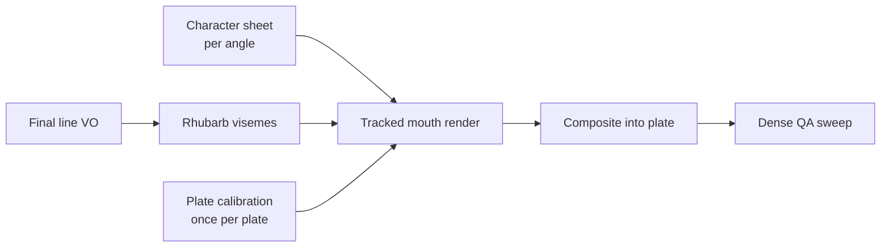

# Lip-Sync Rig System

> [!failure] OWNER-REJECTED (2026-07-01) — do not use for production
> The 2.5D mouth-patch renderer is **anatomically wrong on free-posed heads**: on ¾/down-facing poses the real mouth is an occluded seam under the muzzle, so a pasted frontal mouth reads as a hole in the cheek — no amount of tracking fixes it. QA lesson: judge **anatomy** ("is this where the mouth physically is in this pose?"), never overlay placement. The Rhubarb timing layer remains valid. The replacement approach comes from the pro-pipeline deep research — see [[Lessons Learned]].

> [!abstract]
> The **reusable, zero-credit lip-sync layer** for any character, plate, line, or episode. Final VO → Rhubarb visemes → the character's **authored toothless mouth sheet** → tracked patch composited into the untouched continuous shot. Replaces per-line Kling-Avatar (~40 cr/line + reroll roulette) with **~30 seconds of local compute per line**. Built & proven on EP3 `B_strong`, 2026-07-01.

## Why it exists

Full-frame AI rerolls were the wrong unit of work for a mouth problem: every retry paid for the whole frame, revived the human-teeth risk (see [[Animation Rules]]), and pushed the edit toward the giant-talking-head close-ups the owner rejected. The rig treats lip-sync as **deterministic character animation**: the approved shot stays continuous, only the mouth layer changes. Reuse-first economics per [[Token Efficiency Rules]] — the mouth library compounds; rerolls never did.



## Daily use — one command per line

```bash
python -m bentley.lipsync.pipeline \
  --plate episodes/ep3/lipsync/plates/ep3_strong_ts.json \
  --audio episodes/ep3/vo/B_strong.mp3 --label B_strong \
  --offset -0.28 --out out/B_strong_synced.mp4
```

The plate's mouth track is **cached** — every further line on that plate skips tracking. Full operating manual: `docs/guides/LIPSYNC_SYSTEM_RUNBOOK.md` (repo).

> [!danger] QA gate — ship-blocking
> Every run emits a `.qa.png` **dense frame sweep (every 0.15 s)**. Inspect **every** frame: mouth in place, opens inside the muzzle, closed moments = clean plate, nothing outside visibility windows. Spot-checking a few stills **missed bad frames twice** on EP3. A line ships only after its sweep passes — same spirit as the [[Episode QA Checklist]].

## Onboarding

> [!info] A character is onboarded ONCE (≈1 h), a plate ONCE (≈5 min); lines are then minutes each.

- **Character** → viseme grids per angle (front / ¾ / side) generated from the locked master ([[Bentley Master Prop]]) **plus a real plate-frame crop** as the angle/lighting reference → `sheet_cutter` registers the drifting grid cells and cuts tight patches → **owner approves the sheet** → `assets/lipsync/<char>/character.json`. Guests (Marco, future characters) use the same machinery with their own mouth rules — insect mandibles for Marco, never dog teeth, never human lips.
- **Plate** → `calibrate` writes a grid frame + skeleton JSON. Template = **the mouth region itself** (never nose + fixed offset — head rotation drifts it onto the cheek). Set `visibility` windows: if the camera leaves the speaker or the mouth is a sliver, the rig **stands down** — don't sync a mouth the viewer can't read.

## Hard rules learned (the expensive way)

1. **Toothless v1** (owner-locked): dark interior + tongue — the rig *physically can't* produce a human grin. Puppy-tooth hints = v2 owner-opt-in only.
2. **Closed-mouth plate rule:** dialogue plates destined for the rig are generated with the mouth **closed/calm**. Baked-in "talking" flapping made the EP3 LEAN plate un-patchable.
3. **The plate provides the closed mouth.** Closed visemes render **no patch** — the rig only *adds* openings. Kills sticker-flicker at the source.
4. **Windowed tracking** (`search_radius ≈ 60 px`): the tracker must not teleport to look-alike dark blobs (it found the paw *and* the tag before this).
5. **"Stop. Look. Listen." stays Kling-Avatar** — owner-locked; the rig never touches the catchphrase moment.

## Status & limits

Proven end-to-end on EP3 (`B_strong`, `B_realize` — second line reused the cached track). Honest limits: 2.5D patches don't relight in 3D; fast head-turns need per-segment calibration or a visibility waiver; comp polish (grain match) is minimal. The long-term upgrade path is the Blender rig (plan Phase 6). Full history and review record: `docs/guides/HIGH_QUALITY_LIPSYNC_SYSTEM_PLAN.md`.

Related: [[Production Workflow]] · [[Animation Rules]] · [[Voice Rules]] · [[Lessons Learned]]
